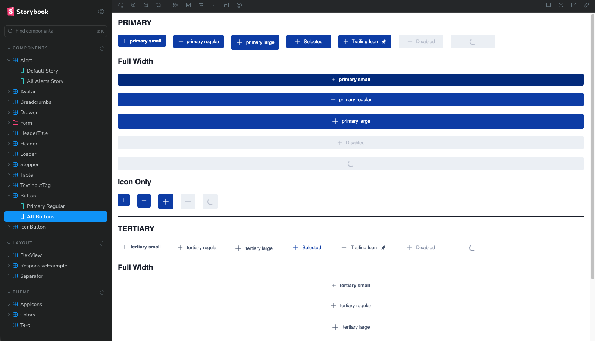
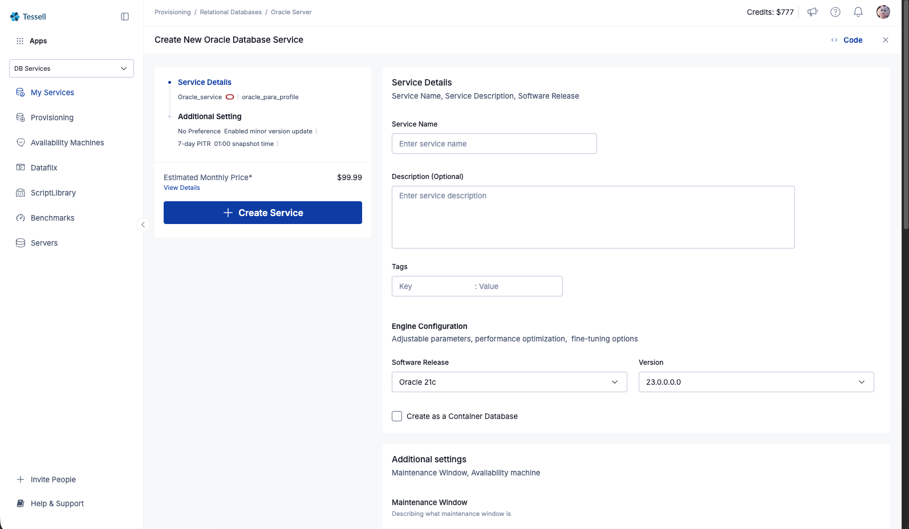

# Cloud DBaaS Design System & Provisioning Interface

<p align="center">
  <a href="https://tessell-storybook.vercel.app/" target="_blank">
    
  </a>
</p>

> **Independent Engineering Case Study**  
> *Architectural implementation of an enterprise-grade Design System and pixel-perfect Cloud Database Provisioning interface, created independently for a candidate technical hiring evaluation.*
>
> 🎯 **Evaluation Outcome**: Delivered with pixel perfection, 100% Storybook component coverage, and was **selected / hired at Tessell**.
>
> 🌐 **Live Application**: [https://tessell-gilt.vercel.app/](https://tessell-gilt.vercel.app/)  
> 📚 **Live Storybook**: [https://tessell-storybook.vercel.app/](https://tessell-storybook.vercel.app/)

---

## 🔗 Live Deployments

| Resource | URL | Status | Description |
| :--- | :--- | :--- | :--- |
| 🚀 **Live Provisioning App** | [tessell-gilt.vercel.app](https://tessell-gilt.vercel.app/) | Active (Vercel) | Interactive Oracle DB creation flow with content-shifting drawer |
| 📖 **Component Storybook** | [tessell-storybook.vercel.app](https://tessell-storybook.vercel.app/) | Active (Vercel) | Full design token documentation & component test stories |

---

## 📖 Table of Contents

- [Live Deployments](#-live-deployments)
- [Overview](#overview)
- [The 72-Hour "Raw Dogged" Challenge](#the-72-hour-raw-dogged-challenge)
- [Why `styled-components`?](#why-styled-components)
- [Design Token Architecture](#design-token-architecture)
- [Component Catalog & Storybook](#component-catalog--storybook)
- [The Provisioning Application Flow](#the-provisioning-application-flow)
- [Methodical Commit History & Timeline](#methodical-commit-history--timeline)
- [Project Structure](#project-structure)
- [Getting Started](#getting-started)
- [Scripts Reference](#scripts-reference)
- [Author](#author)
- [Legal Disclaimer & Fair Use Notice](#️-legal-disclaimer--fair-use-notice)
- [License](#-license)

---

## 🚀 Overview

This repository contains an independent frontend engineering implementation created as a candidate take-home evaluation for Tessell. The objective was twofold:
1. **Design System & Component Library**: Architect a robust, token-driven Design System with isolated, documented components in Storybook.
2. **Pixel-Perfect Application Page**: Implement a multi-step **"Create New Oracle Database Service"** provisioning interface, matching candidate evaluation mockups with pixel precision, fully responsive layouts, content-shifting collapsible drawer navigation, and end-to-end interactive state management.

---

## ⚡ The 72-Hour "Raw Dogged" Challenge

This project was built under rigorous real-world constraints:

- **Strict 72-Hour Delivery Window**:
  - **First Commit**: `2025-07-05 20:10:39 +0530`
  - **Final Commit**: `2025-07-08 19:52:06 +0530`
  - **Elapsed Time**: **71 hours, 41 minutes** — delivered completely under the 72-hour deadline.
- **Zero Paid Figma Plugins / Dev Mode**:
  - Completed without access to paid Figma Dev Mode or automated code-generation plugins.
  - Every margin, padding, border radius, hex code, typography rule, and SVG vector was manually inspected, calculated, and translated into reusable tokens and styled primitives.
- **Pre-Agentic AI Era**:
  - Handcrafted from the ground up without AI code-generation agents or auto-scaffolders. Every token hierarchy, styled component, Storybook CSF3 story, layout shift guard, and form hook was written and debugged by hand.

---

## 🛠️ Why `styled-components`?

The decision to choose **`styled-components`** over alternatives (Tailwind CSS, CSS Modules, or Chakra UI) was strategic:

1. **Battle-Tested Experience at Cuemath**:
   - I had deep prior experience architecting enterprise Design System components at **Cuemath** using `styled-components`. That hands-on background meant I knew the exact patterns needed for token injection, performance optimization, and theme scaling without trial-and-error overhead.
2. **Token-Driven Theming via `<ThemeProvider>`**:
   - A design system demands strict adherence to centralized tokens. `styled-components` provides first-class TypeScript-typed theme context, ensuring components only consume validated tokens for colors, spacing, typography, and breakpoints.
3. **Transient Props (`$prop`)**:
   - Utilized styled-components transient props (e.g., `$size`, `$type`, `$isSelected`, `$gapX`, `$heightX`) to guarantee clean, collision-free DOM attributes without React DOM attribute leakage warnings.
4. **Dynamic Layout & Content-Shifting**:
   - Tessell's layout required a Collapsible Navigation Drawer that dynamically pushes and shrinks the main content canvas rather than merely overlaying on desktop, while collapsing into an overlay on mobile and tablet. `styled-components` made state-driven layout transitions seamless and responsive.

---

## 🎨 Design Token Architecture

The design system is built upon a scalable multi-tier token hierarchy located in [`src/theme/`](./src/theme):

### 1. Semantic Color Tokens ([`src/theme/theme-colors/`](./src/theme/theme-colors))
- **Surfaces**: `surface-100` (pure white canvas), `surface-200` (sidebar/subtle backgrounds), `surface-300` (borders/dividers), `surface-400` (neutral active backgrounds).
- **Primary & Secondary**: Distinct brand blues, purples, and contextual shades (`primary-100`, `primary-200`, `primary-300`, `secondary-*`).
- **Typography Colors**: `text-primary`, `text-subtler`, `text-subtlest`, `text-inverse`.
- **Status & Alerts**: Explicit semantic palettes for `success`, `warning`, `danger`, and `opacity` layers (e.g., modal backdrop overlays).

### 2. Strict Typography Tokens ([`src/theme/theme-text/`](./src/theme/theme-text))
- Based on Google's **Inter** font family loaded via CDN.
- Managed through the polymorphically styled `<Text $renderAs="..." />` component:
  - `heading/primary` (18px, bold)
  - `heading/secondary` (16px, semi-bold)
  - `heading/form titles` (14px, medium)
  - `Text-body/primary/primary` (14px, regular)
  - `Text-body/secondary/secondary` (12px, regular)
  - `Text-body/secondary/subtlest` (12px, muted)

### 3. Spacing & Layout Multipliers ([`src/theme/theme-spacing/`](./src/theme/theme-spacing))
- Standard baseline unit with `GAP` and `GUTTER` constants.
- Dynamic multiplier props (`$gapX`, `$heightX`, `$widthX`, `$marginBottomX`) across primitives like `<FlexView />` and `<Separator />` for mathematically consistent rhythm.

### 4. Breakpoints & Media Query Engine ([`src/theme/constants/`](./src/theme/constants))
```typescript
export const BreakpointDevices = {
  mobile: 0,
  tablet: 768,
  desktop: 1024,
  widescreen: 1440,
};
```
- Reusable CSS template helpers in `MediaQuery` (`minWidthMobileOnly`, `minWidthTablet`, `minWidthDesktop`, `minWidthWidescreen`).
- Reactive hook [`useCurrentBreakpoint()`](./src/hooks/use-current-breakpoints.tsx) for JavaScript-level responsive behavior.

### 5. Unified SVG Icon System ([`src/assets/icons/`](./src/assets/icons))
- 34+ custom SVG icons extracted directly from Figma and transformed into first-class React components via `vite-plugin-svgr`:
  - Navigation: `Drawer`, `Switcher`, `Provisioning`, `MyServices`, `AvailabilityMachines`, `Servers`, `DataFlix`, `ScriptLibrary`, `Benchmarks`
  - Actions & Controls: `Add`, `CirclePlus`, `Check`, `Close`, `Delete`, `Sort`, `Calendar`, `Clock`, `CmdE`, `Bell`, `Code`
  - Logos: `TessellLogo`, `TessellTypoLogo`, `OracleLogo`

---

## 🧩 Component Catalog & Storybook

> 📚 **Interactive Storybook**: Explore all components, themes, and states live at [tessell-storybook.vercel.app](https://tessell-storybook.vercel.app/)

<div align="center">
  
  <p><strong>Figure 1: Component Library & Design Tokens in Storybook</strong><br />
  <em>Interactive component documentation, state permutations, accessibility testing, and token catalog.</em></p>
</div>

Every component was built with accessibility, reusability, and comprehensive Storybook stories:

| Category | Component | Description & Variants |
| :--- | :--- | :--- |
| **Primitives & Layout** | [`<FlexView />`](./src/components/flex-view) | Flexbox container supporting `$direction`, `$alignItems`, `$justifyContent`, `$gap`, `$gapX`, and `$wrap`. |
| | [`<Separator />`](./src/components/separator) | Spacing divider supporting arbitrary or token-based width, height, and color. |
| **Form Controls** | [`<TextInput />`](./src/components/text-input) | Input with label, placeholder, leading/trailing icons, help text, and error validation states. |
| | [`<TextInputTag />`](./src/components/textinput-tag) | Interactive chip tag input with Enter/Comma submission, chip deletion, and imperatively exposed `getTags()` / `clear()` refs. |
| | [`<Dropdown />`](./src/components/dropdown) | Custom styled dropdown select with custom items, active checks, and icon attachments. |
| | [`<Checkbox />`](./src/components/checkbox) | Custom SVGs for checked, unchecked, and indeterminate states with zero layout shifting. |
| | [`<Radio />`](./src/components/radio) | Accessible styled radio input with custom inner dot animation and focus ring. |
| **Actions & Buttons** | [`<Button />`](./src/components/button) | Variants: `primary`, `secondary`, `tertiary`, `danger`. Sizes: `small`, `regular`, `large`. Supports loading spinners and icons. |
| | [`<IconButton />`](./src/components/icon-button) | Circular and square icon buttons for headers, toolbars, and action trays. |
| **Feedback & Navigation** | [`<Alert />`](./src/components/alert) | Semantic alert banners with status icons and dismissible actions. |
| | [`<Avatar />`](./src/components/avatar) | User profile avatar with fallback initials and image error handling. |
| | [`<Breadcrumbs />`](./src/components/breadcrumbs) | Path hierarchy navigation with clickable links. |
| | [`<Stepper />`](./src/components/stepper) | Multi-step wizard indicator with step summary labels, actions, and active/completed states. |
| | [`<Drawer />`](./src/components/drawer) | Collapsible navigation sidebar with company logo, workspace switcher, and grouped navigation buttons. |
| | [`<Header />`](./src/components/header) | Enterprise application header with breadcrumbs, command bar (`Cmd+E`), credit counter, alerts, and user avatar. |
| | [`<HeaderTitle />`](./src/components/header-title) | Page title header with action buttons and sidebar collapse trigger. |
| **Data Display** | [`<Table />`](./src/components/table) | Enterprise data table supporting custom headers, sort indicators, checkboxes, tag badges, and row action buttons. |
| | [`<Loader />`](./src/components/loader) | Fluid SVG circular loading spinner. |

---

## 🖥️ The Provisioning Application Flow

> 🚀 **Live Demo**: Test the full interactive multi-step provisioning workflow at [tessell-gilt.vercel.app](https://tessell-gilt.vercel.app/)

<div align="center">
  
  <p><strong>Figure 2: Cloud Database Provisioning Application</strong><br />
  <em>Pixel-perfect recreation of the multi-step database provisioning workflow with content-shifting drawer navigation.</em></p>
</div>

The root application demonstrates these design system components in a real-world enterprise workflow: **"Create New Oracle Database Service"** ([`src/pages/provisioning/`](./src/pages/provisioning)).

### Core Features:
1. **Collapsible Drawer with Dynamic Content Shifting**:
   - Desktop: Toggling the drawer smoothly resizes the main workspace without covering content.
   - Tablet/Mobile: Drawer automatically defaults to collapsed mode to preserve screen real estate.
2. **Service Details Step**:
   - Service name input with instant empty-state validation.
   - Tag manager utilizing `<TextInputTag />` with validation requiring at least one tag.
   - Oracle Software Release and Version dropdown pickers.
   - Toggle checkbox for Multitenant Container Database (CDB) architecture.
3. **Additional Settings Step**:
   - Radio buttons for Maintenance Window preference (`No Preferences` vs `Select Window`).
   - Day of week picker, start time input, and duration dropdown.
   - Availability machine data table with SLA guarantees and automated snapshot schedules.
4. **Interactive Stepper & Async Submission**:
   - Clicking **"Create Service"** initiates form validation and simulates an asynchronous API call (3-second loading state overlay).
   - On completion, the stepper advances to Step 2 with an animated smooth scroll into the next section.
   - Final submission triggers a styled **SweetAlert2** modal confirming database service deployment.

---

## 📜 Methodical Commit History & Timeline

Every milestone was committed with clean, descriptive git messages over the 71-hour sprint:

```
2025-07-05 20:10  8c9e3d0  Initial commit
2025-07-05 20:20  4b656c3  Cleanup init files
2025-07-05 21:36  254f2d4  Themes added to project along with Text and Color Pallette story
2025-07-05 21:44  d4ce564  Shown all texts inside the story like color story, moved them to theme folder
2025-07-05 23:44  1ece04e  Theme overhaul and stories updated
----------------------------------------------------------------------------------------------------
2025-07-06 01:13  16e000f  Added assets and svgr problem fixed
2025-07-06 01:51  14fbe90  Appicons ready to use
2025-07-06 12:33  2ed0700  Flexview and Separator added
2025-07-06 13:22  deb4227  Buttons revamped work is done
2025-07-06 15:50  f49b65d  Texttinput added
2025-07-06 17:11  3a781a8  Dropdown readyy
2025-07-06 18:55  0b6ac9f  Checkbox dodne
2025-07-06 19:13  a56b5fb  Radios done
2025-07-06 19:22  605fb20  Stlyes updated for radio
2025-07-06 23:31  19206d8  Added Inter font through CDN
----------------------------------------------------------------------------------------------------
2025-07-07 00:35  87dfa3d  Alert comp added
2025-07-07 00:53  f970897  Breadcrumbs comp added
2025-07-07 01:12  0528d12  Avatar comp added
2025-07-07 02:47  7471710  Stepper added
2025-07-07 12:24  39425df  Header comp done
2025-07-07 12:54  293f4c5  Header Title ready
2025-07-07 13:40  cb45a8a  Tertiary button style added
2025-07-07 16:03  41cd9db  Drawer UI ready 💪
2025-07-07 16:24  b747a38  Drawer open close functionality added
2025-07-07 16:33  27daf78  Improvements in Drawer comp
2025-07-07 17:32  805c469  Responsive story and code utils added
2025-07-07 17:56  34e084b  Refactoring
2025-07-07 18:12  8028229  yarn compile added & refactoring
2025-07-07 18:25  8e385a7  Responsive and Media queries are constant now
2025-07-07 19:57  c653f8b  Drawer context initialised and content shifting achieveed
2025-07-07 21:34  0453586  Create service section ready, other small cleanup
2025-07-07 22:07  c189a85  Layout ready for provisioning screen
2025-07-07 22:54  96c0af8  Radios and Checkboxes updated, Service Details section initial ready
2025-07-07 23:47  3beb1a9  Page ready
----------------------------------------------------------------------------------------------------
2025-07-08 00:01  69fd901  Minor enhancements
2025-07-08 01:51  d7252f3  Table row done and Table comp ready to roll
2025-07-08 02:21  340aeaa  Responsive screen ready
2025-07-08 02:37  4df614e  Header made responsive and Drawer hidden by deafult on Tab and Smaller devices
2025-07-08 02:43  75ffc12  Viewdetails changed to link
2025-07-08 02:46  e61ee41  Bulid issues fixed
2025-07-08 11:10  92b09e4  Added textinput tag
2025-07-08 11:15  c291aa4  Minor enhancements for tag textinput
2025-07-08 11:52  b12aaa5  Checkboxes styles updated
2025-07-08 12:33  b629271  Radio states done
2025-07-08 13:13  b552b67  Drawer story updated
2025-07-08 15:07  b4cd9f6  Service section ready
2025-07-08 16:50  db7f70d  Dummy API call and Api integration ready
2025-07-08 17:23  f7dd3f1  Contextualised stuff here
2025-07-08 17:32  81b37c0  Layout shift in checkboxes fixwd
2025-07-08 17:36  4ba24f7  Cleanup
2025-07-08 17:47  ca08c6d  Added gihtub profile to heaer
2025-07-08 18:52  9feb2b9  Textinput storyupdate
2025-07-08 18:56  ce78cd6  Minor UI fixes
2025-07-08 19:32  7e64b3b  Icon button fix
2025-07-08 19:34  7266a00  Deprecate redundant props from drawer
2025-07-08 19:52  2b09419  minor story book fixes
```

---

## 📁 Project Structure

```
react-design-system/
├── .storybook/                  # Storybook configuration & preview decorators
│   ├── main.ts
│   ├── preview.tsx              # Wraps all stories with ThemeProvider & AppDefaultTheme
│   └── vitest.setup.ts
├── src/
│   ├── assets/icons/            # 34+ SVGs imported as React components
│   ├── components/              # 18 reusable Design System components
│   │   ├── alert/
│   │   ├── avatar/
│   │   ├── breadcrumbs/
│   │   ├── button/
│   │   ├── checkbox/
│   │   ├── drawer/
│   │   ├── dropdown/
│   │   ├── flex-view/
│   │   ├── header/
│   │   ├── header-title/
│   │   ├── icon-button/
│   │   ├── loader/
│   │   ├── radio/
│   │   ├── separator/
│   │   ├── stepper/
│   │   ├── table/
│   │   ├── text/
│   │   ├── text-input/
│   │   └── textinput-tag/
│   ├── constants/               # Global constants & profile links
│   ├── context/
│   │   └── drawer-context/      # Collapsible drawer state & layout shift manager
│   ├── hooks/                   # Breakpoint & responsive hooks
│   ├── pages/
│   │   └── provisioning/        # Oracle DB Provisioning screen implementation
│   ├── stories/                 # Comprehensive Storybook stories
│   │   ├── components/          # Component stories
│   │   ├── layout/              # Layout & responsive stories
│   │   └── theme/               # Token stories (Colors, Text, Icons, Buttons)
│   ├── theme/                   # Token definitions (Colors, Spacing, Typography, etc.)
│   ├── app-root.tsx             # Root page mounting
│   └── main.tsx                 # Entrypoint with ThemeProvider & DrawerProvider
├── package.json
├── tsconfig.json
└── vite.config.ts
```

---

## 🛠️ Getting Started

### Prerequisites
- **Node.js**: v18.0.0 or higher (v20+ recommended)
- **Yarn**: v1.22+ or **npm**

### Installation

Clone the repository and install dependencies:

```bash
git clone https://github.com/rishav-jha-mech/react-design-system.git
cd react-design-system
yarn install
```

---

## 💻 Scripts Reference

| Command | Action |
| :--- | :--- |
| `yarn dev` | Starts the Vite development server for the Provisioning page at `http://localhost:5173` |
| `yarn storybook` | Launches Storybook 9 environment with all component stories at `http://localhost:6006` |
| `yarn build` | Runs TypeScript compilation (`tsc -b`) and generates production Vite bundle |
| `yarn build-storybook` | Generates a static production build of the Storybook documentation |
| `yarn compile` | Verifies TypeScript build without emitting bundle (`yarn tsc --build --verbose`) |
| `yarn lint` | Runs ESLint analysis across codebase |

---

## 👨‍💻 Author

**Rishav Jha**
- **GitHub**: [@rishav-jha-mech](https://github.com/rishav-jha-mech)
- **Live Provisioning App**: [https://tessell-gilt.vercel.app/](https://tessell-gilt.vercel.app/)
- **Live Component Storybook**: [https://tessell-storybook.vercel.app/](https://tessell-storybook.vercel.app/)
- **Portfolio Context**: Technical interview take-home assignment evaluation for Tessell

---

## ⚖️ Legal Disclaimer & Fair Use Notice

> ### 📌 Independent Portfolio Demonstration & Trademark Notice
>
> 1. **Non-Affiliation**: This repository is an independent technical demonstration and personal portfolio case study authored solely by [Rishav Jha](https://github.com/rishav-jha-mech). It is **not** an official product, codebase, or repository of **Tessell Inc.**, **Oracle Corporation**, or their subsidiaries. It is not officially endorsed, sponsored, affiliated with, or authorized by Tessell Inc.
> 2. **Clean-Room Implementation**: All source code, design token definitions, theme structures, state controllers, and components in this project were written independently from scratch using standard open-source technologies (React, styled-components, TypeScript, Vite, and Storybook). No proprietary company source code, private internal APIs, confidential business logic, production keys, or internal customer data are present or used in this repository.
> 3. **Nominative Fair Use**: All brand names, company names, product names, trademarks, and logos (such as "Tessell" and "Oracle") referenced in this repository belong to their respective owners. Their mention is strictly nominative and descriptive, intended solely to provide context for the technical interview prompt and demonstrate design fidelity under the Fair Use doctrine.
> 4. **Educational & Portfolio Purpose**: This repository is published strictly for non-commercial educational purposes, peer review, and personal technical portfolio display.
> 5. **Contact & Inquiries**: If you are an authorized representative of Tessell Inc. or any mentioned entity and have any questions, concerns, or requests regarding this portfolio repository, please reach out directly to the author at [rishav.rj74@gmail.com](mailto:rishav.rj74@gmail.com) for prompt assistance.

---

## 📄 License

This project is open-source software licensed under the [MIT License](./LICENSE).
